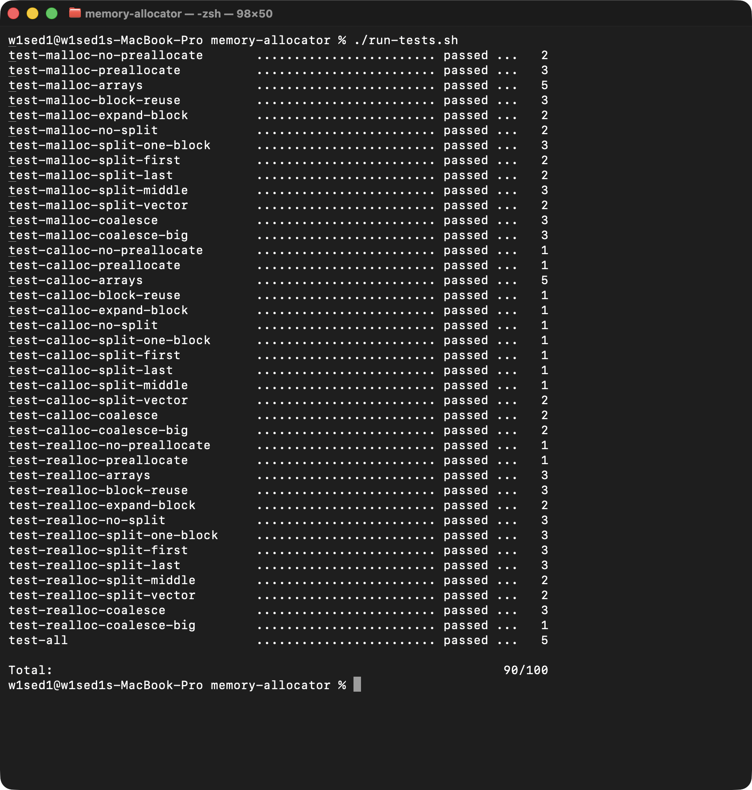

# Memory Allocator

Мінімальний алокатор пам'яті мовою C: `os_malloc()`, `os_calloc()`, `os_realloc()`, `os_free()`.
Виконано за завданням
[open-education-hub/operating-systems — memory-allocator](https://github.com/open-education-hub/operating-systems/tree/main/content/assignments/memory-allocator).

Уся реалізація знаходиться у [`src/osmem.c`](src/osmem.c). Каталоги `utils/` і `tests/` скопійовано із завдання без змін.

## Результат тестів

Усі 40 тестів проходять разом із перевіркою витоків пам'яті (valgrind): **90/100**. Це максимум, який дає `run_tests.py`;



## Як запустити

Тести використовують `ltrace`, `valgrind` і системні виклики Linux (`brk`, `mmap`), тому на macOS вони запускаються в Docker-контейнері з Ubuntu 22.04 (див. [`Dockerfile`](Dockerfile)):

```sh
./run-tests.sh
```

На Linux (потрібні `gcc`, `make`, `python`, `ltrace`, `valgrind`):

```sh
cd tests
make check
```

## Як влаштовано

Кожен блок пам'яті починається зі структури `struct block_meta` (32 байти), одразу за нею йде payload. Користувач отримує адресу payload. Розміри вирівнюються до 8 байтів.

| Що                                                                 | Як                                                                                                                |
| ------------------------------------------------------------------ | ----------------------------------------------------------------------------------------------------------------- |
| Малі блоки (`META + size < 128 KiB`, для `calloc` — `< page size`) | на heap через `sbrk()`                                                                                            |
| Великі блоки                                                       | окремий `mmap()`, статус `STATUS_MAPPED`, звільнення через `munmap()`                                             |
| Перше використання heap                                            | одразу резервується 128 KiB (heap preallocation), далі цей блок ділиться                                          |
| Пошук вільного блоку                                               | **best fit**: найменший вільний блок, у який влазить запит                                                        |
| Split                                                              | якщо після виділення залишається місце хоча б на `block_meta` + 8 байтів, залишок стає новим вільним блоком       |
| Coalesce                                                           | перед кожним пошуком сусідні вільні блоки зливаються                                                              |
| Немає підхожого блоку                                              | якщо останній блок heap вільний, він розширюється через `sbrk()` на різницю, інакше в кінець додається новий блок |
| `os_free()` на heap                                                | блок лише позначається `STATUS_FREE` і пам'ять не повертається ОС                                                 |

Блоки heap утворюють двозв'язний список (`prev`/`next`), упорядкований за адресою. `mmap`-блоки до списку не входять: щоб їх звільнити, достатньо розміру із заголовка.

### `os_realloc()`

1. `ptr == NULL` → `os_malloc(size)`; `size == 0` → `os_free(ptr)` і `NULL`; блок зі статусом `STATUS_FREE` → `NULL`.
2. Блок на heap і новий розмір менший за поріг:
   - якщо блок уже достатньо великий, він обрізається (split) на місці;
   - інакше до нього по одному приєднуються наступні вільні блоки, і після кожного злиття перевіряється розмір. Злиті блоки так і лишаються злитими, навіть якщо місця не вистачило;
   - якщо блок останній на heap, програмний break зсувається на різницю.
3. В усіх інших випадках (`mmap`-блок, перехід через поріг, розширити на місці не вдалося) виділяється новий блок, дані копіюються, старий звільняється.

Помилку кожного системного виклику (`sbrk`, `mmap`, `munmap`) перевіряє макрос `DIE()`.
